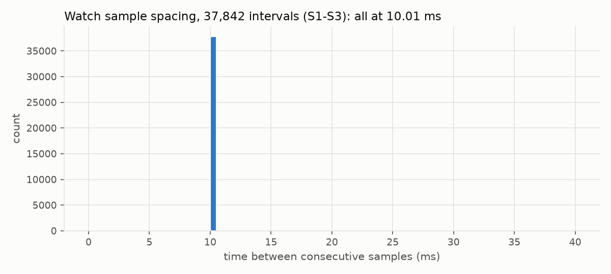
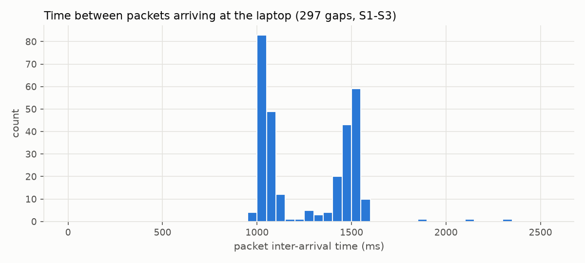
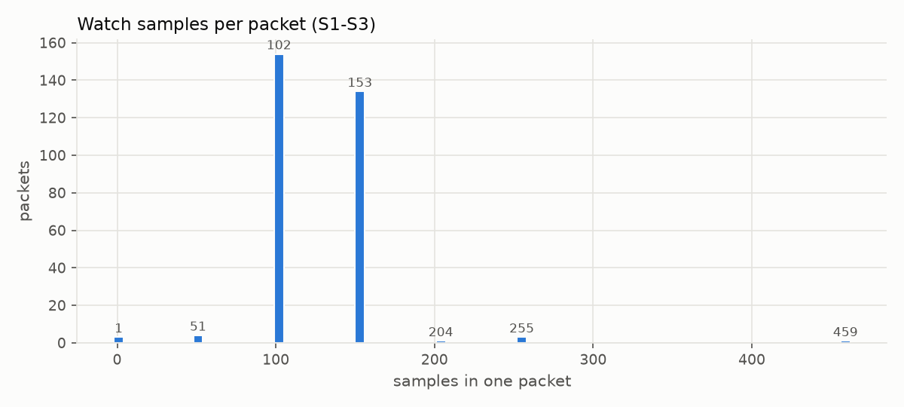
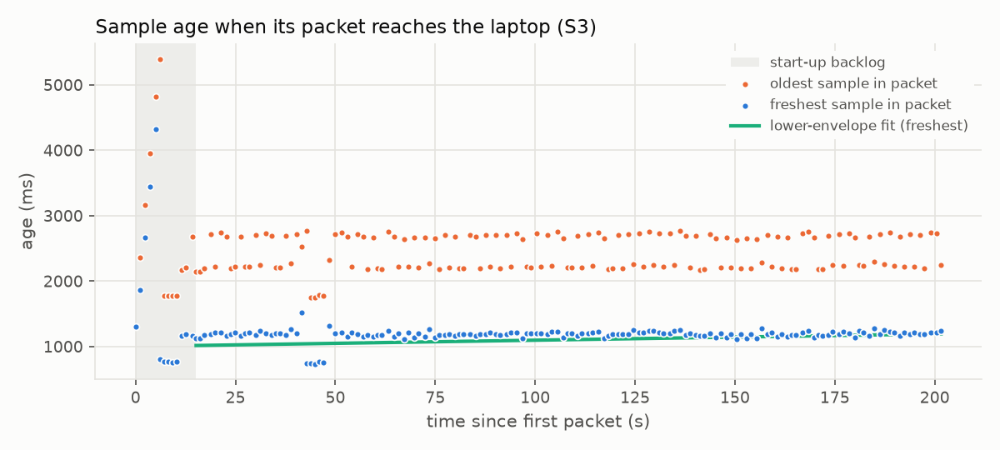
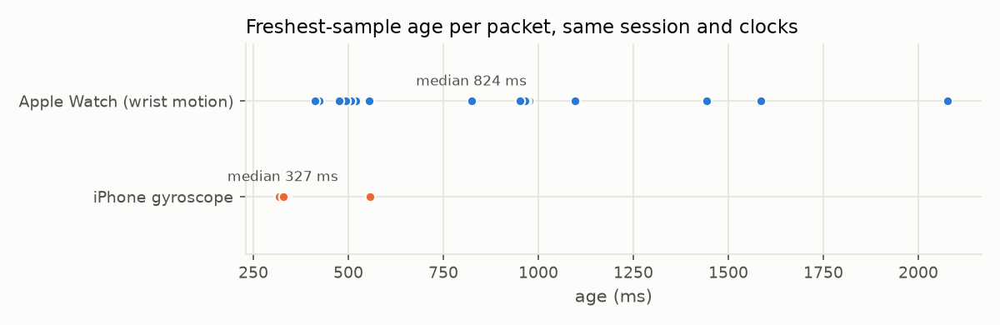
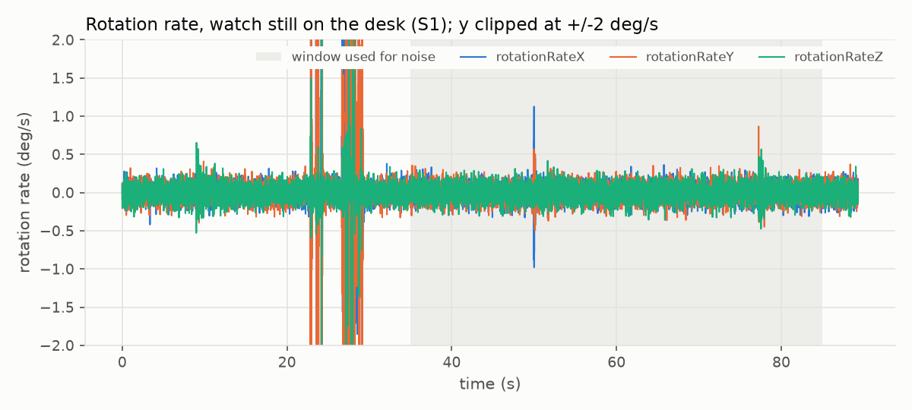
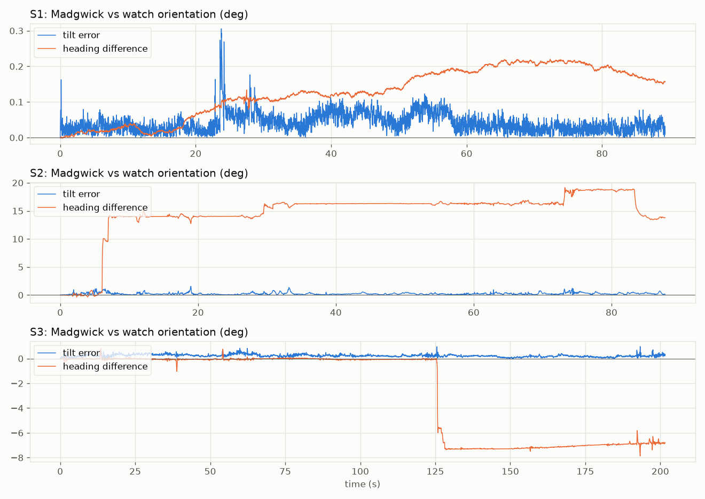
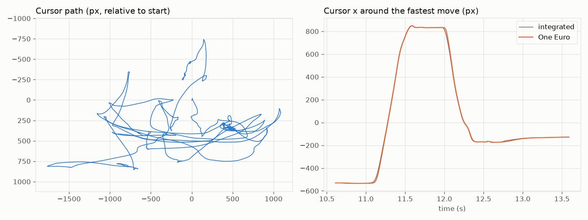

# Results

## Phase 0

**Status: measured on the real device (23 Nov 2026).** Apple Watch -> iPhone (Sensor Logger
1.69, free tier, HTTP push) -> home Wi-Fi -> Windows laptop. All numbers below come from
recorded sessions and `scripts/phase0_analyze.py` (settings in `configs/phase0_analysis.yaml`).

### Summary

- **Watch data arrives live, complete and at ~100 Hz.** 37,845 watch samples over 6.3 min:
  99.9 Hz, no gaps, no lost messages, no out-of-order samples.
- **But it arrives in ~1 s batches, and each sample is already 0.7-2.7 s old on arrival.**
  The phone pushes every 1.0-1.5 s (free tier), and the watch hands data to the phone in
  fixed **51-sample (~0.51 s) chunks**, which add delay before the phone's push timer.
- **Recommendation: GO for data collection, training and offline/replay work. Live,
  low-latency control is NOT achievable with this setup as measured**, and may not be fixed
  by the paid 100 ms push because of the watch-side chunking (see the go/no-go below).

### What was recorded

| Label | Session folder | Note | Purpose |
|---|---|---|---|
| verify | `20261123-151651` | phone still, only the wrist moving; phone + watch sensors on | Identify the watch stream; phone vs watch delay |
| S1 | `20261123-152941` | watch still on the desk | Rate, noise floor, gyro bias |
| S2 | `20261123-153207` | wearing the watch, moving around | Rate and timing under motion |
| S3 | `20261123-153509` | wearing the watch, mixed activity | Longest session; delay over time |

Notes: S2 ended up with general movement similar to S3 (fine for these timing measurements).
S3 was planned as 10 min but contains 3.4 min of data. Two earlier S1 attempts (21 s and a
2-packet fragment) are kept on disk but not used.

**The watch stream.** Sensor Logger sends the watch data as `"wrist motion"`. With the phone
lying still and only the wrist moving, the phone gyroscope stayed at ~0.001 rad/s while
`wrist motion` rotation reached 12 rad/s (~690 deg/s), so this stream is the watch. It is
Apple's processed device-motion output (rotation rate, gravity, user acceleration,
quaternion, roll/pitch/yaw). Separate raw accelerometer/gyroscope streams were not
offered for the watch.

### Measured numbers (watch stream)

| | S1 | S2 | S3 |
|---|---|---|---|
| Duration (s) | 89.3 | 87.8 | 201.6 |
| Watch samples | 8,926 | 8,773 | 20,146 |
| Rate from median spacing (Hz) | 99.92 | 99.92 | 99.91 |
| Rate from count / duration (Hz) | 99.92 | 99.92 | 99.91 |
| Spacing std (ms) | 0.000 | 0.001 | 0.000 |
| Out-of-order or duplicate samples | 0 | 0 | 0 |
| Gaps (> 1.5 x period) | 0 | 0 | 0 |
| Lost messages (messageId gaps) | 0 | 0 | 0 |
| Packets | 70 | 70 | 160 |
| Packet interval p50 / p95 / max (ms) | 1243 / 1571 / 2340 | 1113 / 1538 / 1550 | 1171 / 1546 / 1595 |
| Samples per packet p50 / p95 / max | 102 / 153 / 255 | 102 / 153 / 153 | 102 / 153 / 459 |
| Packet size, median (KiB) | 61.1 | 59.3 | 59.6 |
| Sample age p50 / p95 (ms) | 1715 / 2673 | 1799 / 2561 | 1814 / 2628 |
| Freshest-sample age min / p50 / max (ms) | 742 / 1149 / 2225 | 754 / 1193 / 1297 | 737 / 1191 / 4321 |

"Sample age" is laptop receive time minus the sample's timestamp. It compares two clocks, so
it includes their offset; the laptop clock was measured at ~0.19 s from internet time
(`w32tm /stripchart`), so treat absolute ages as +/-0.2 s.

**Effective sample rate.** 99.9 Hz (10.01 ms spacing) in every session, and the two rate
estimates agree to 0.01 Hz, so nothing is missing.

**Jitter.** The spacing between watch timestamps is *exactly* 10.01 ms (std of 1 us or less).
Real sensor timestamps normally wobble by microseconds, so these timestamps are very
likely reconstructed as start + n x period somewhere in the watch/app pipeline. We
therefore **cannot measure the true sampling jitter**, but for our pipeline the stream is
already on a uniform 100 Hz grid. Packet arrivals do jitter (below).

**Burstiness.** Packets arrive every ~1.05 s or ~1.5 s (two clusters), carrying 102 or 153
samples. **Every packet except the first of a session holds a multiple of 51 samples**
(51, 102, 153, 204, 255, 459): the watch delivers data to the phone in 51-sample (~0.51 s)
chunks and each phone push carries the 2 or 3 chunks that arrived since the last push.

**Gaps and loss.** None: 0 timestamp gaps, 0 missing message ids, 0 out-of-order samples in
all three sessions. At the start of each recording the app first flushes a backlog of
buffered watch data (samples up to ~5 s old) before settling.

**Delay over time (S3).** After the start-up backlog, the freshest sample in each packet is
~1.15-1.25 s old, with occasional stretches at ~0.75 s; the oldest is ~2.2 or ~2.7 s
(2-chunk vs 3-chunk packets). The lower-envelope line fit gives an intercept of ~1.0 s and a
slope of +953 ppm, but that slope comes from the switch between the ~0.75 s and ~1.2 s
levels, not from clock drift (phone and laptop clocks drift by tens of ppm at most).
**Clock drift is not measurable from 3.4 min of data with this delay behaviour.**

**Phone vs watch delay.** In the verify session (same clocks for both), the freshest phone
gyroscope sample was 327 ms old (median) on arrival and the freshest watch sample 824 ms:
the watch link adds **~0.5 s** on top of the phone's own batching, matching the 0.51 s chunk
size. (This assumes the app maps watch timestamps onto the phone clock correctly; a tap test
that hits phone and watch together would confirm it.)

**Noise floor and gyro bias (S1, 35-85 s, watch untouched).** The watch was bumped around
22-30 s, so that span is excluded.

| Axis | Mean / bias (deg/s) | Std / noise (deg/s) |
|---|---|---|
| rotationRateX | +0.001 | 0.103 |
| rotationRateY | -0.003 | 0.105 |
| rotationRateZ | +0.000 | 0.105 |

The bias is essentially zero: Apple's device-motion processing already removes gyro bias.
Phase 2 still needs a stillness check, but bias estimation may turn out unnecessary.

### End-to-end latency with 240 fps video

Not measured yet. With the free tier's ~1 s batching the video would mostly measure the
batching, so this is deferred until live streaming is tested (DECISIONS D-007). The method:

1. Show something on screen that reacts immediately to a sharp acceleration spike (from
   Phase 2 the live dashboard; before that, a small "flash" window can be added).
2. Film at **240 fps slow-motion** (Camera -> Slo-mo; check Settings -> Camera -> Record
   Slo-mo is 240 fps) with the watch and the laptop screen both in the shot.
3. Tap the watch sharply on the desk ~20 times, a few seconds apart.
4. For each tap, count frames from impact to the first frame where the screen changes;
   latency = frames / 240 s (one frame is about 4.17 ms).
5. Report median and spread. A 60 Hz display adds up to ~16.7 ms on its own.

### Go / no-go

| Criterion | Threshold | Measured | Result |
|---|---|---|---|
| Watch IMU data arrives live | Yes | Yes, `wrist motion` at 99.9 Hz | **Pass** |
| Gyroscope effective rate | >= 50 Hz | 99.9 Hz | **Pass** |
| Packet loss / gaps | < 1 % of time | 0 gaps, 0 lost messages | **Pass** |
| Median packet interval | <= 100 ms | 1113-1243 ms (free tier) | **Fail** |
| End-to-end latency | p50 <= 150 ms | Not measured; sample age p50 ~1.8 s | **Fail (expected)** |

### Recommendation

- **GO** for Phase 1 (ingest, resampling, record/replay), Phase 3 (data collection) and
  Phase 4 (models): the recorded data is complete, regular and 100 Hz, and batching does
  not affect it.
- **GO** for the offline parts of Phase 5 (ONNX export, streaming inference on replayed
  data, INT8 quantization, OpenVINO and Snapdragon profiling).
- **NOT YET** for live pointer control. The paid 100 ms push removes the phone-side
  batching, but the watch-side 0.51 s chunking would likely remain, leaving roughly
  0.5-1 s of delay: too slow for a cursor, borderline for discrete gestures. When the
  subscription is taken (one month is enough), the first step is to re-run the probe for a
  few minutes and check whether packets still hold 51-sample chunks. If they do, live control
  needs a different data path (another app, or a native watch app if a Mac becomes
  available).

## Phase 1

Ingest pipeline checks on the three Phase 0 recordings, converted to sessions with
`scripts/convert_probe_session.py` and replayed with `scripts/replay_session.py`.

| Session | Raw samples (99.9 Hz) | Grid frames (100 Hz) | Invalid frames | Dropped samples | Fast replay | Digest (first 12) |
|---|---|---|---|---|---|---|
| S1 (89.3 s) | 8,926 | 8,932 | 0 | 0 | 0.01 s | `fd9f93f4597f` |
| S2 (87.8 s) | 8,773 | 8,779 | 0 | 0 | 0.01 s | `0fef07e08660` |
| S3 (201.6 s) | 20,146 | 20,162 | 0 | 0 | 0.04 s | `53cc20f974f0` |

- **Determinism:** replaying each session twice gives the same digest. S1 replayed at 20x
  real time (4.44 s) gives the same digest as the instant replay: timing does not change
  the output. Tests also require streaming output to equal offline resampling exactly.
- **More frames than samples:** the watch runs at 99.9 Hz, so a 100 Hz grid over the same
  time span has ~0.1 % more points (e.g. 20,162 vs 20,146 over 201.6 s).
- **Processing cost:** parsing excluded, resampling one ~1 s packet (102-153 samples) and
  writing it to the ring buffer takes p50 0.11 ms, p95 0.18 ms, p99 0.29 ms on the Intel i7
  (3,200 packets, ~0.9 us per sample). Negligible next to the ~1 s transport batching.
- **Live path:** an end-to-end run of `ingest_live.py` on localhost, fed with 5 real Phase 0
  packets and stopped with Ctrl+Break, recorded all 562 samples and completed the metadata.

## Phase 2

DSP and pointer results on the three Phase 0 recordings (S1 still on the desk; S2 and S3
normal arm motion), with the settings in `configs/dsp.yaml` and `configs/pointer.yaml`.
Produced by `scripts/compare_orientation.py` and `scripts/pointer_replay.py`.

### Madgwick vs the watch's own orientation

Madgwick starts from the watch's orientation and then runs on the gyro and accelerometer
alone, so these numbers show how far the two drift apart.

| Session | Length (s) | Tilt error p50 (deg) | p95 | max | Heading slope (deg/min) | Max heading difference (deg) | Still (%) | Max bias estimate (deg/s) |
|---|---|---|---|---|---|---|---|---|
| S1 | 89 | 0.04 | 0.09 | 0.31 | +0.15 | 0.22 | 91 | 0.023 |
| S2 | 88 | 0.21 | 0.60 | 1.57 | +6.43 | 19.14 | 0 | 0.000 |
| S3 | 202 | 0.22 | 0.41 | 0.98 | -2.94 | 7.88 | 0 | 0.020 |

- **Tilt** (which way is down) agrees within 0.6 deg at p95 in every session, including fast
  motion.
- **Heading** does not drift steadily. It changes in **steps during the fastest movements**
  (S2 at 6 s, S3 at 125 s) and is nearly flat in between (S3: under 0.2 deg over the first two
  minutes). Integrating the 100 Hz samples cannot reproduce what Apple's own fusion sees,
  probably a higher internal sample rate and its own heading corrections. The slope column
  is therefore not a drift rate. The pointer does not use heading (D-016).
- **Gyro bias:** Core Motion has already removed it; our estimate stays at or below
  0.023 deg/s.

Madgwick gain sweep on S3 (why `madgwick_beta` is 0.01):

| beta | Tilt error p50 (deg) | p95 |
|---|---|---|
| 0 (gyro only) | 1.05 | 7.72 |
| 0.01 | 0.21 | 0.41 |
| 0.04 | 0.27 | 0.67 |
| 0.1 | 0.39 | 1.12 |
| 0.3 | 0.69 | 2.28 |

With beta = 0 nothing corrects the tilt and it drifts to 7.7 deg (p95). Too large a beta lets
arm acceleration be mistaken for gravity.

### Pointer on replayed sessions (clutch forced on)

| Session | Cursor travel | Final offset | Double knocks found |
|---|---|---|---|
| S1 (still) | 16 px in 89 s | (1, 3) px | 0 |
| S2 (motion) | 29,922 px | (-30, -271) px | 0 |
| S3 (motion) | 10,784 px | (-690, -294) px | 0 |

- With the watch still, the dead zone keeps the cursor practically motionless.
- The right panel zooms in on the fastest movement. The One Euro output follows the raw
  integrated position closely during the sweep (little lag at high speed) and smooths small
  wiggles at rest.
- **Knock detector false triggers:** none in about 6 minutes of everyday motion. That motion's
  knock signal reached p99.9 0.38 g and 0.88 g at most against the 0.6 g threshold, so it is
  the timing rules, not the threshold alone, that prevent false toggles. A recording with
  deliberate knocks is needed to tune the threshold (open item).

### Playout delay vs smoothness (real packet arrival times)

Each session's recorded packets were fed through the playout buffer at their original
arrival times with a fake clock (30 s floor window). An underrun is a moment when the next
frame is due but has not arrived: the cursor pauses, then catches up.

| Delay (s) | S1 underruns (89 s) | S2 underruns (88 s) | S3 underruns (202 s) | Longest pause S1 / S2 / S3 (ms) |
|---|---|---|---|---|
| 1.5 | 34 | 34 | 76 | 1255 / 494 / 1382 |
| 2.0 | 6 | 0 | 4 | 755 / 402 / 1086 |
| **2.5 (default)** | 3 | 0 | 2 | 343 / 402 / 1046 |
| 3.0 | 0 | 0 | 1 | 343 / 402 / 546 |

- Packets need about 1.5 s of margin at the median (that is the packet length itself) and
  1.6-2.5 s at p95. One 3.6 s network stall in S3 causes an underrun at any reasonable
  delay.
- The ~400 ms pause in S2 is the start-up, before the floor has settled.
- **Resulting lag on the free tier:** the newest-sample age floor is about 0.75 s
  (+/-0.2 s clock offset), so the cursor plays about 0.75 + 2.5 = **~3.2 s behind the
  hand**, smoothly. The paid 100 ms push would shorten packets and allow a much smaller
  delay; this needs re-measuring on that tier.

### Processing cost per tick (Intel i7, 100 Hz, one frame per tick, S3)

| Stage | p50 (ms) | p95 (ms) | p99 (ms) |
|---|---|---|---|
| DSP (bias, low-pass, Madgwick) | 0.12 | 0.28 | 0.46 |
| Pointer (mapping, gain, One Euro, knock detector) | 0.21 | 0.48 | 0.74 |
| Cursor move (GetCursorPos + SendInput) | 0.32 | 0.63 | 1.14 |

Under 1.5 ms per 10 ms tick at p95, in plain Python loops.

### Live path

`pointer_live.py --dry-run --no-dashboard` on localhost, fed with 6 real packets over HTTP
and stopped with Ctrl+Break: all 663 frames were played back in order at a steady 100 Hz
through the playout buffer, the session was recorded, and the process exited cleanly. Not yet tested with
the watch streaming live (owner checklist).
